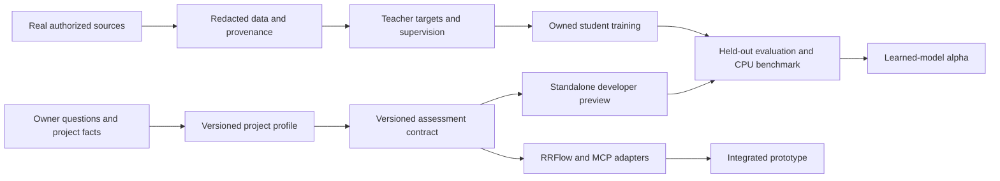

# LFG: developer build to learned alpha

**Status note, 2026-11-02:** The inventory in “What is real today” and the
original next slice below are historical: PR #123 merged the unified assessment,
bounded discovery and browser-local question profiles. See the dated
[integration and training research](INTEGRATION-AND-TRAINING-RESEARCH.md) for
the current verified baseline, cross-repository findings and next packages.

**Purpose:** turn the existing local work into a usable developer preview, a
standalone assessment prototype that can participate in RRFlow, and ultimately
LFG's own trained language model. This is an execution plan, not a statement
that those outcomes have already been delivered. Status and measurements below
are observations as of 2026-11-01; recheck them before making release claims.

The owner's objective and constraints are in [AGENTS.md](../../AGENTS.md),
[product and delivery](PRODUCT-AND-DELIVERY.md), and
[model and distillation](MODEL-AND-DISTILLATION.md). In particular, LFG should
explain intent, complexity, model suggestions and agent count; run usefully on
its own; expose a friendly UI and developer tools; and optionally integrate
with RRFlow, SWAG, MCP and cloud services. The approximately 650 MB model
target is a design constraint to measure, not an already achieved size.

## What is real today

| Area | Evidence and limits |
| --- | --- |
| Runtime and UI | Main has a deterministic Rust runtime, guided UI and Inspector. A Windows release build with embedded UI was run from a copied directory. That proves a local development path, not a trained model or clean-machine release. [Bundled UI](BUNDLED-UI.md) records earlier reproducibility evidence. |
| Developer diagnostics | Inspector exposes bounded process-local timings and can export a snapshot. `dev-log` records changed snapshots to an operator-selected, size-limited local file. It is not a service manager, distributed trace, CPU-cycle measurement, or audit log. [Developer observability](DEVELOPER-OBSERVABILITY.md). |
| Unified assessment | A separate, currently uncommitted worktree is running an experimental assessment endpoint and UI. An isolated snapshot, `codex/assessment-reconciliation`, was reconciled with main and its existing Rust and UI tests passed. Its session scanning still needs configurable budgets and its privacy change needs integration and verification. Neither worktree is a merged or released model. Preserve the original live worktree during reconciliation. |
| Questions and app facts | The recovered [question banks](BOUNDARY-QUESTION-BANK.md) contain 425 numbered owner-authored questions across eight banks. A configurable artifact/fact preview exists. The unnumbered source material is not fully transcribed, and previews neither persist answers nor constitute live RRFlow integration. [Project intake](APP-INTAKE.md) is a separate derived template, not the complete original notes. |
| Training data | The local combined review workspace reported 598 pending training requests, including 569 with labels pending, zero approved decisions and zero verified flags. It has no validation or test entries. These are real source candidates, not 598 complete instruction/response examples or proof of dataset sufficiency. [Assessment distillation](ASSESSMENT-DISTILLATION.md) prepares explicitly selected teacher traces; it does not collect teacher answers or train a generative student. |
| Model and hardware | Existing fine-tuning and assessment-head experiments are not LFG's own generative language model in the runtime. A bounded local RTX 5090 CUDA fixture verified a toolchain path, not real-data training or model quality. The Spark access observed in the last audit was denied for the current SSH identity; establish the authorized identity before using it. [Local CUDA lab](LOCAL-CUDA-LAB.md), [Spark environment](SPARK-LOCKED-ENVIRONMENT.md). |
| Integration | The local RRFlow contract describes optional LFG observations, SWAG policy and RRFlow engine admission. It says the actual LFG adapter/conformance and engine-admitted execution are not complete. MCP and hosted authorization are also unfinished. |

## Release names and dependency order

Use these distinct labels in the UI, release notes and manifests:

1. **Developer preview:** an embedded-UI binary, deterministic assessment,
   configurable local project intake, supervision and diagnostic tooling.
   It must run on its own and accurately disclose unfinished integrations.
2. **Integration prototype:** the same versioned assessment works standalone
   and through an actual RRFlow adapter; failures, budgets and provenance are
   tested end to end. A deterministic implementation is acceptable here.
3. **Learned-model alpha:** an independently evaluated, owned LFG language
   model is trained, packaged and run through the same assessment contract.
   Its limitations and measured hardware behavior accompany the artifact.

Tracks for data, model work, UI and integration can proceed concurrently once
their contracts are defined. Human approval and promotion gates decide which
results may be relied on; they do not prohibit exploratory training on
authorized local data. Unreviewed, synthetic, fixture and real reviewed data
must remain distinguishable in every report.

## 1. Finish one coherent developer preview

**Next implementation slice:** reconcile the live unified-assessment snapshot
with current main and the merged diagnostics, rather than overwriting either.
Carry over the isolated privacy fix; replace unbounded session and configuration
scans with validated, operator-configured limits for bytes, files, memory and
work per refresh. Use resumable progress and fair scheduling so a large history
cannot monopolize startup or permanently starve other sources. Show incomplete,
disabled, failed and stale source states; do not claim an exhaustive inventory
when a limit or read error intervenes. Verify file replacement, truncation,
partial records, malformed data and limits. Never turn provider history into
proof of a current subscription or a successful outcome.

Define one versioned assessment request and result shared by the UI and the
future adapters. The result carries intent, complexity, agents, model/effort
suggestions, reasons, source/configuration/model identities, and explicit
unknown or unavailable states. Rule scores are not probabilities. Preserve
existing endpoints during migration and make any disagreement between legacy
and unified assessments visible until their callers are migrated.

**Done when:** a clean checkout builds a copied, embedded-UI executable; an
operator can launch it without RRFlow or Node; enter a request; see a plain
explanation and Inspector diagnostics; connect a local review workspace; and
restart without corrupting state. Test disabled and oversized inputs, offline
operation, missing configuration, source privacy, bounded collection and the
actual binary. Report exactly which local files and data were used. The
currently running process and the standalone developer build are separate
until that reconciliation is implemented and verified.

## 2. Make the owner's questions and project profile usable

1. Finish locating and transcribing the remaining source notes, including the
   unnumbered curriculum and routing material. Preserve exact source text,
   location, bank, ordering, revision and the distinction between authored
   questions and derived intake questions.
2. Define versioned templates with question identity, source reference,
   expected value and units, required/optional status, configurable app-fact
   bindings, source priority, validation and allowed unknowns. Keep questions,
   thresholds, provider/model catalogs and mappings in replaceable
   configuration with digests and migration rules.
3. Build adapters that read only explicitly configured project artifacts and
   app facts. Resolve app-supplied values and collected evidence into a
   **preview** with provenance, missing/stale/conflicting states and proposed
   values. Preserve project-specific overrides; never silently replace an
   explicit value or invent an entitlement.
4. Let a human or the user's authorized integrating AI review, complete and
   explicitly apply the preview; store the versioned profile locally with
   history and rollback. Expose the same operation through a documented API
   and, later, MCP. Answers and source artifacts need separate privacy controls.
5. Show discovered and declared subscriptions, adapter capabilities, models,
   effort levels, quotas and freshness per project. Provider observations,
   user declarations and verified entitlements are distinct. Unknown stays
   unknown; no compiled-in vendor list is the source of truth. Changes from a
   global catalog cannot overwrite a project's choices.

**Done when:** an actual authorized RRFlow or DevPulse project supplies a
configured subset of facts; the UI shows the owner's exact questions and their
source-backed proposed values; missing/conflicting answers stay visible; an
explicitly applied profile survives restart; and edits, imports and rollback
are covered by tests. The current preview alone does not meet this criterion.

## 3. Build the real supervised dataset and evaluation corpus

Create a local, versioned data manifest with source project, session or
conversation group, authorization, source revision/digest, extraction time,
redactions, label or teacher provenance, review status and outcome evidence.
Keep source text and learned artifacts derived from private data out of Git and
do not send private data to a hosted teacher without an authorized route and
the operator's chosen disclosure. An authorization to use the owner's local
projects is not evidence that every line is secret-free or successful.

- Inventory variety by project, language, task, complexity, prompt length,
  conversation context and outcome. Use the existing owner data and selected,
  license-compatible additional corpora only when their rights and relevance
  are recorded. Do not claim a sufficient size before measuring quality and
  coverage; the current 598 candidates are not a training-ready SFT corpus.
- Extract real requests and enough surrounding context to interpret follow-ups.
  Redact secrets before preparation. Preserve uncertain, unreviewed and failed
  examples as such; do not silently turn generated labels into human truth.
- Produce actual assessment targets: intent, complexity, agent count,
  model/effort suggestions and concise observable reasons, tied to the
  relevant project profile. Capture selected local teacher outputs or
  explicitly authored targets, their exact source and model/configuration
  versions. Do not invent teacher responses or hidden reasoning.
- Reserve independent projects or conversation families for validation and a
  final held-out test before teacher generation, tuning or selection. Audit
  exact and near duplicates across splits and keep uncertain relationships
  flagged. Maintain a separate owner-authored question and task acceptance set.
- Use the existing review interface to inspect provenance and correct or reject
  examples. Capture disagreement and reasons; measure inter-reviewer agreement
  where independent review is available. Dataset volume, review completeness,
  outcome coverage and model correctness are separate metrics.

**Done when:** a manifest can reproducibly build a private train set and
separately held-out evaluation sets from real authorized sources, report
coverage and unresolved leakage, and support a first actual run. Exploratory
training can start earlier if it is labeled exploratory and does not consume
the final test set. Training data is sufficient only after measured learning
curves and held-out behavior support the intended capability.

## 4. Train LFG's own student and make training repeatable

The present repository has an encoder trainer and a teacher-trace preparation
path, not a generative student trainer. Define the owned tokenizer,
architecture, initialization, context and output schema; implement causal
training, checkpoint/resume, optimizer and schedule configuration, mixed
precision, gradient accumulation, deterministic seeds where supported, and
immutable input/toolchain/model manifests. Record non-deterministic operations
and hardware instead of promising bit-identical GPU runs.

An original model needs an initialized language-capable student before
instruction fine-tuning can teach the assessment behavior. The owner's project
data may be enough for a task-specific experiment but is not yet evidence of a
sufficient general-language pretraining corpus. Estimate tokens, training
compute, accelerator memory, storage and wall time for candidate sizes; run
measured small pilots on the available Spark or authorized local GPU before
committing to a scale. Explicitly identify any additional licensed data,
teacher access, hardware or time required. Do not rename someone else's model
as LFG. Teacher weights, teacher text outputs and the owned student's weights
are separate artifacts with their own rights and provenance.

Use a configurable experiment matrix: student size/architecture, context,
training tokens, data mixture, loss and teacher. Compare a simple random or
representative selection with any proposed sophisticated selection. Preserve
raw teacher-output SFT as one path; token-level/logit distillation is available
only where teacher outputs, vocabulary alignment and rights actually permit it.
Later test on-policy methods against the simpler baseline; do not describe them
as implemented merely because a paper reports results.

Each run must produce a manifest, data/split digests, model and tokenizer
identity, seed, source revision, environment lock, hardware, loss/throughput,
checkpoint and evaluation results. A stopped run must resume or fail without
silently changing inputs. Treat partially trained and unreviewed artifacts as
experimental, not release candidates.

For planning, estimate the main dense-model training work as approximately
`6 × active_parameters × training_tokens` floating-point operations; this is a
rough sizing model, not a promise of elapsed time or an exact formula for
attention, activation checkpointing, sparse models or teacher inference.
For illustration only, one billion active parameters trained over one billion
tokens gives roughly `6 × 10^18` operations under that approximation; this is
not a proposed LFG architecture, token target or measured Spark throughput.
Measure sustained tokens/second, peak memory and checkpoint cost on the chosen
hardware, then estimate duration from the measured rate and token budget.
Include teacher generation, evaluation, failed/restarted runs and storage in the
resource plan. The owned causal student can minimize configured next-token
cross-entropy over valid target tokens; task or distillation losses and their
weights are explicit experiment configuration, with masking and normalization
recorded. A low training loss alone is not acceptance evidence.

## 5. Evaluate and optimize on the machines users actually have

Build a frozen real-task evaluation with separately reported intent and
complexity agreement, agent-count error, useful model/effort selection given
known availability, unknown/abstention behavior, reason faithfulness and
security-sensitive failure cases. Compare the same cases to the deterministic
baseline and any candidate student; retain per-project slices, confidence
intervals where sample size permits and human review of disagreements.
Calibrated confidence may appear only after measuring calibration on data not
used to tune it. Record prompt/output format and generation budget.

Benchmark cold start, warm prefill and end-to-end response at declared prompt
lengths and concurrency, p50/p95 elapsed time, real process CPU time, cycles
where supported, peak RAM, executable/model size and energy if actually
measured. Record OS, CPU, GPU, power state, thread settings, build and artifact
digests. Separate UI/server overhead from model work and include quality after
quantization. Establish the target-device matrix and numerical budgets from
the first real baseline and product requirements, then store them as versioned
configuration; do not present an arbitrary number as an achieved guarantee.

Use hardware-in-the-loop trials to compare the owner's hybrid/short-convolution
research direction with simpler owned baselines. Record kernel availability,
cache behavior and end-to-end results. KV-shard layout, invalidation and
folding organizational knowledge into weights are hypotheses to evaluate, not
established properties of the current system. Package only artifacts that pass
the chosen quality, provenance and resource gates; preserve rollback to the
deterministic path and report any quality or performance regression.

Record elapsed time as the monotonic end-to-end duration for a named boundary;
record CPU time from an actual process/thread counter, and cycles only from an
available hardware counter. For `n` retained samples sorted by elapsed time,
the nearest-rank p95 is sample `ceil(0.95 × n)` using one-based indexing; report
`n`, errors and the sampling window with it. These metrics answer different
questions and cannot be substituted for one another. Fixed thresholds are
chosen and versioned after measuring the baseline and target requirements.

## 6. Wire standalone, RRFlow, SWAG and MCP without changing authority

Keep one core assessment contract with explicit input limits, time/resource
budgets, versioned observations, source/configuration identity, units and
missing/inconclusive/error states. Local UI and local API call that core
directly. A typed MCP adapter exposes the same operations with appropriate
transport authorization and explicit tool effects; it must not silently pass
through credentials or turn an observation into permission. Follow the
[MCP security guidance](https://modelcontextprotocol.io/docs/2025-11-25/tutorials/security/security_best_practices)
and the selected protocol version at implementation time.

For RRFlow, implement the actual adapter and conformance tests against its
current `docs/reference/inference/lfg-swag.md` and Gate G contract. RRFlow's
engine admits requests, owns authorization and budgets, and commits effects;
LFG contributes optional observations; SWAG selects and dispatches only via
the admitted path. Validate timeouts, cancellation, unavailable LFG, stale or
unknown capability data, idempotency and correlation through the real
components. A successful standalone HTTP request or a fixture adapter is not
evidence of a completed RRFlow integration. Hosted access needs authenticated,
authorized transport before exposing administration or diagnostic data.

**Done when:** the same real assessment can be invoked standalone and through
an admitted RRFlow flow, with versions, correlation, budgets, failures and
effects verified from input to receipt; standalone use remains functional when
RRFlow/SWAG is absent. Ship local MCP and hosted adapters only after their own
conformance and access-boundary tests.

## 7. Operate, update and release

- Evolve Inspector from bounded process-local traces into configured collection,
  export and retention with clear coverage and dropped-event counts. Correlate
  LFG and RRFlow traces without recording prompts, secrets or hidden reasoning
  by default. Separate elapsed time, CPU time and cycles; show unavailable
  metrics honestly. Address opt-in persistence, restarts and file rotation.
- Provide a validated configuration editor for project profiles, model/provider
  adapters, effort and routing policies, limits, data sources and diagnostics.
  Secret references go to an appropriate secret store; no credentials go into
  configuration exports. Preview changes and retain the last valid version on
  failure.
- Version binary, UI, configuration, model/tokenizer and optional adapters
  independently. Define authenticated update manifests, compatibility and
  integrity checks, trust roots, staged rollout, offline behavior, health
  checks and rollback. A newer global default must not erase project settings.
- Qualify each supported platform using reproducible builds where practical,
  artifact/SBOM verification, clean-machine install/upgrade/uninstall, offline
  operation and resource/quality results. Distinguish the model's approximate
  size target from total binary, runtime memory and optional assets.
- User-adapted weights need explicit authorized inputs, local/remote resource
  controls, provenance and isolation, held-out evaluation, reversible activation
  and removal. Do not assume adapter merging preserves quality or privacy.

## Spark execution status and next decisions (2026-11-02)

The Spark is accessible as `clyffy-03`. An owned 19,264,512-parameter
byte model completed 100,000 pretraining steps on the screened owner corpus;
its 349-proposal assessment fine-tune also completed. The lab publisher
delivered a 369-proposal superset and its subsequent fine-tune also completed. The
persistent services, dataset boundaries, evaluation and dashboard are
described in [the training service](CONTINUOUS-TRAINING-SERVICE.md) and
[the continual handoff](CONTINUAL-DATA-HANDOFF.md). All proposals have unknown
outcomes and are unreviewed; this is exploratory training, not a qualified
model. The first 10-request development-format check yielded two JSON
objects with required fields and eight invalid responses; it did not test
recommendation accuracy. The ~650 MB owned model and self-contained runtime
remain future work.

The next execution sequence is:

1. Investigate the first assessment format failures and observe the completed
   369-record update's development report. Investigate service failures
   and preserve checkpoint and dataset lineage; do not treat JSON formatting
   as recommendation accuracy.
2. Expand authorized train sources with provenance and secret screening;
   capture actual results and reviewer corrections. Select untouched project or
   conversation families for a blind final test before using them for model
   selection. Distinguish verified outcomes from teacher suggestions.
3. Evaluate intent, complexity, model and effort recommendations, and agent
   counts against reviewed cases and the deterministic baseline. Report
   missing labels, uncertainty, slices and failures; training may continue
   regardless of evaluation outcome.
4. Size and train candidate owned architectures using measured Spark
   throughput and quality, then package the runtime, model and developer UI
   as a reproducible local build. Benchmark cold/warm CPU latency, memory,
   throughput and failure behavior on intended user hardware.
5. Exercise the versioned RRFlow and SWAG boundaries with real configured
   services, and add authenticated hosted operation and signed, reversible
   model updates. Keep standalone operation available.

The publisher only processes configured, completed collections; it does not
automatically discover new projects or create reviewed outcomes. Expanding
collection and review is required for sustained new learning.

## Immediate work queue

1. **Reconcile the assessment prototype:** preserve the live worktree; apply
   the isolated privacy fix; add configurable bounded incremental scanning and
   tests; merge with supervision and diagnostic UI; verify one copied executable.
2. **Make the question workflow persistent:** finish source-note inventory;
   implement project-bound mappings, provenance, explicit apply and rollback;
   prove with a real configured project without exporting private facts.
3. **Create an assessment data pilot:** select real authorized project/session
   groups, hold out separate groups, redact, capture genuine targets and review
   a representative subset. Report actual counts, missing targets and outcomes.
4. **Implement a real student-training vertical slice:** choose and record an
   owned tokenizer and small owned architecture; train and resume on permitted
   local data; evaluate against the deterministic baseline. Start on available
   hardware while the Spark identity is resolved; do not substitute a fixture
   run for this milestone.
5. **Build the RRFlow seam:** agree the versioned observation contract with the
   RRFlow implementation, then implement and exercise the real admitted adapter.
6. **Qualify the developer preview:** record build provenance, clean-machine
   behavior, resource measurements, diagnostics and known limits; automate
   checked merges only for complete work with passing checks.

Keep each item linked to its commit, test results, data/artifact manifests and
unresolved issues. Do not mark a track complete based solely on plans, synthetic
fixtures, an empty test set, a merged branch or a successful build.

## Inputs and decisions to resolve

| Input | Why it matters | Work that can continue meanwhile |
| --- | --- | --- |
| Spark workload and resource budgets | `clyffy-03` is accessible and running training; resource budgets and coexistence with other workloads still need measurement. | Continue bounded training and log throughput, memory, and recovery behavior. |
| Project/conversation groups reserved for final testing | Independence must be chosen before tuning, teacher generation or using those cases for selection. | Inventory source families, redact and conduct train-only exploratory work on other authorized data. |
| Additional general-language data and teacher route | The current request inventory does not establish enough language coverage to initialize an owned generative student; hosted routes also need permitted disclosure and applicable terms. | Build the tokenizer, student/trainer and local source/teacher interfaces; measure a small local pilot. |
| Target devices, concurrency, quality and resource budgets | Size, speed and quality trade-offs cannot be qualified without declared workloads and acceptance values. | Measure the existing deterministic baseline and collect candidate requirements; avoid presenting guesses as targets already met. |
| RRFlow contract and admission implementation | LFG cannot independently complete an engine-owned execution path. | Implement the standalone contract and adapter tests, then coordinate against the real RRFlow branch and actual admitted flow. |

These are not reasons to pause the independent work. Record each decision,
its owner, date and evidence in the relevant artifact or change when resolved.

## Research informing experiments

- Liquid AI's [LFM2 technical report](https://arxiv.org/abs/2511.23404) and
  [LFM3 architecture report](https://www.liquid.ai/blog/lfm3) motivate measuring
  candidate architectures on actual target hardware. LFM3's performance and
  training-scale claims are vendor reports, not LFG measurements; its weights
  are not LFG's model.
- [Beyond Prompt Count](https://arxiv.org/abs/2609.37377), a 2026 preprint,
  found selection effects depend on the teacher/student/task and targeted
  selection did not consistently beat random sampling in its experiments.
  Use this as a reason to compare baselines, not as a guarantee for LFG.
- [How Output Format Confounds Data Quality and Capability](https://arxiv.org/abs/2609.02015),
  a 2026 preprint, motivates reporting output format and generation budget
  when comparing training and evaluation. Its results do not validate LFG.
