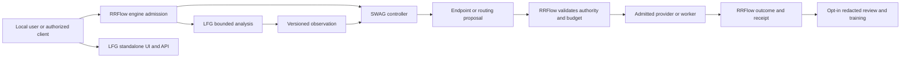

# LFG integration and training research

**Research date:** 2026-11-02. This is an engineering decision and delivery
record, not an assertion that the proposed interfaces, model or integrations
are implemented. It supplements the [developer-to-alpha plan](DEVELOPER-TO-ALPHA-PLAN.md)
and does not replace RRFlow's roadmap or SWAG's own delivery rules.

## Objective

Deliver an owned, CPU-first LFG language model and understandable local developer
experience that classifies requests, explains the evidence for its suggestions,
and can operate alone or supply a versioned observation to RRFlow and SWAG.
The owner wants a self-contained binary and roughly 650 MB model target, real
project-derived supervision, configurable limits and user-specific project and
subscription profiles. The size is a design target, not measured achievement.
The UI must expose both helpful plain-language explanations and developer timing,
provenance and review state. LFG's initial deterministic assessment remains a
useful baseline while an owned learned model is built and evaluated.

## Evidence and scope

The inspected revisions are LFG main `f798134548286d28d8efbab69de77d4c5dc0d87f`,
RRFlow development main `e6f3632b32f1c9be33c1951886a9d9a2be648ddf`, and SWAG
main `e8d66b7997039b659037a7fc42fc9d772b910098`. Fetch and check them again
before implementation; they can change independently.

| Area | Existing evidence | Still missing |
| --- | --- | --- |
| LFG runtime | `POST /api/lfg/assess` returns deterministic intent, complexity, agents and model suggestions. PR #123 joins it with supervision, diagnostics, bounded history discovery, and browser-local profile review. A copied Windows executable served its embedded UI and all 425 questions. | Learned owned model; independent clean-machine portability and performance qualification; service persistence, secure hosted operation and actual integration. |
| Questions | 425 numbered questions are preserved. Ten source notes were archived privately; configured project artifacts can populate a proposed preview with source metadata. | Unnumbered curriculum/routing material needs transcription and validation; RRFlow preview covered only some bindings; durable portable profile storage and authenticated synchronization are not implemented. Local browser review is an assertion and plaintext storage. |
| Data | Private split reservation has 598 train, 47 validation and 785 test candidate requests. Exact normalized text, family IDs and declared groups were checked for cross-split overlap. One actual current request has an unreviewed assistant-assessment pilot. | The candidates are not an approved training corpus: redaction and independent target review are incomplete, shared-context and near-duplicate leakage remain possible, and the reserved test set must not tune the model. |
| Spark | Historical GB10 CUDA smoke, checkpoint/resume, and a pinned-model forward/backward probe establish limited mechanics. The historical locked environment was later flagged for high-severity vulnerabilities. | A newly patched, verified, pinned ARM64 environment; a real-data run, representative sequence-length capacity, CPU export and quality evidence. Do not use the old lock for real training or untrusted inputs. |
| RRFlow | Its contract separates optional LFG analysis, SWAG selection and engine authority. Code at the revision above implements experimental `RrdEngine::propose_task_endpoint`, `EndpointSelectionRequest`, and generated `TaskEndpointPropose` client access. | LFG observation adapter and end-to-end admitted execution remain open. The RRFlow inference reference still says no public proposal operation exists; that sentence conflicts with its current code and SWAG's PR206 evidence and needs an RRFlow-owned documentation correction. The proposal operation alone does not execute the selected worker or establish routing quality. |
| SWAG | Its local MCP bridge exposes `health`, `developer_status`, `rrflow_status` and a legacy `decision_route` preview. Its documentation records a real experimental engine proposal with one configured candidate. | No verified LFG-to-SWAG observation handoff or complete connected task workflow. A one-candidate proof is transport/admission evidence, not selection-quality evidence. Subscription client logins are not transferable API keys or proof of API entitlement. |

The RRFlow discrepancy can be checked directly in the pinned
[engine implementation](https://github.com/rrflow/rrflow-development/blob/e6f3632b32f1c9be33c1951886a9d9a2be648ddf/crates/authority/rrd-engine/src/engine/endpoint_proposal.rs),
[native public-client example](https://github.com/rrflow/rrflow-development/blob/e6f3632b32f1c9be33c1951886a9d9a2be648ddf/crates/transport/rrd-client/examples/controller_proposal.rs),
and [inference reference](https://github.com/rrflow/rrflow-development/blob/e6f3632b32f1c9be33c1951886a9d9a2be648ddf/docs/reference/inference/lfg-swag.md).
SWAG's own `README.md`, `docs/current-context.md`, and
`docs/developer-workspace.md` describe the narrower observed proof and its limits.

The local LFG API and supervision services must not be assumed safe for public
exposure. No private prompts, archives, credentials, pilot examples or review
labels are included in this record.

## Chosen boundaries

LFG owns its analysis, explanation, model and project-profile interface. SWAG
owns controller behavior and can consume an LFG observation as optional input.
`RrdEngine` owns authenticated task and source identity, admitted capabilities,
budgets, effects, recovery and durable receipts. An LFG recommendation, MCP tool
call, provider login, project profile, or SWAG proposal is not permission to
perform an effect. An unavailable LFG must result in an explicit missing or
failed observation; any deterministic fallback must be selected by policy and
reported, not silently treated as a successful learned prediction.

**Do not retrofit LFG fields into the current RRFlow proposal request.** At the
inspected revision, `EndpointSelectionRequest` rejects unknown fields and takes
task and configuration identities, not a caller-supplied prompt, candidate list,
or observation. RRFlow must define and implement the engine-owned path for an
authorized, validated LFG observation and its inclusion in any route packet.
Use the existing `TaskEndpointPropose` operation only within its documented
experimental semantics; evolve its owner-approved contract when needed.

### Proposed LFG observation contract — design, not a shipped schema

Create a separately versioned, bounded request/response owned by LFG and
reviewed against RRFlow Gate G before implementation. Use typed fields and
explicit limits from configuration, with at least:

- Request: schema version; caller/task correlation references; input or
  authorized input reference and digest; requested analyses; project-profile
  revision/digest if present; deadline and input/output/resource ceilings.
  References and digests identify data; they do not themselves prove it is
  authorized or trustworthy. Include only the data needed for analysis.
- Response: schema version and request identity; analyzer kind (`rules` or a
  specific learned artifact), executable/configuration/model digests and
  declared taxonomy revision; features with bounded values, units and reason
  identifiers; per-field available, missing, inconclusive, failed or stale
  status. Confidence is absent unless its meaning and calibration are measured.
- Recommendations: distinguish LFG's suggested model role, effort and agent
  count from a provider endpoint choice. The eligible provider/model inventory
  and subscription declarations are separately versioned configuration, with
  source, freshness and unknown state. A declared subscription, local session
  or sign-in check cannot by itself establish paid entitlement, API access,
  quota, price, or authorization. Never embed a fixed provider ranking in code.
- Failure: reject malformed versions, oversize payloads, stale required
  configuration, identity/digest mismatches and expired deadlines; return
  typed, content-free errors. A timeout, crash, incompatible model, unknown
  subscription or unsupported effort must not authorize a fallback effect.

Use a canonical serialization and hash definition shared by implementations;
define normalization, byte limits, compatibility and migration explicitly.
Model and profile updates cannot silently change the meaning of prior receipts.
Observations should be extensible without letting unknown fields become new
permissions. Test cross-language serialization and replay on actual binaries.

### Project facts and the owner's authored questions

Keep the question catalog, application bindings, validation rules and model
profiles versioned and replaceable. Preserve original question/source identity.
Build a preview from explicitly scoped RRFlow project evidence and other
configured apps; show source, digest, timestamp, missing/stale/conflicting
facts and whether an answer is proposed, edited or reviewed. The integrating AI
may propose answers, but must not silently mark them human reviewed or invent
subscription availability. An explicit apply creates a new durable revision;
rollback creates a new revision referencing the prior one. Preserve manual
overrides and show conflicts on refresh.

The current browser store proves a local interaction pattern only. A next
profile service needs an owning store, access control, atomic compare-and-swap,
portable export/recovery, retention and deletion, and a defined migration from
browser revisions. RRFlow-backed storage is optional through its authorized
public operations; standalone LFG must continue to work without RRFlow. Do not
claim a shared, encrypted or synchronized profile until those properties are
actually implemented and tested.

## Research decisions

1. **MCP is a transport adapter, not the core authority.** Start with a local
   stdio server exposing read-only assessment and question/profile-preview tools
   through the same bounded core. MCP's [transport specification](https://modelcontextprotocol.io/specification/2025-11-25/basic/transports)
   defines stdio and Streamable HTTP. The [2026-07-28 release](https://blog.modelcontextprotocol.io/posts/2026-07-28/)
   introduces a stateless core; choose a pinned supported SDK/protocol version
   and test negotiation with the actual Codex, Claude and SWAG clients instead
   of assuming every client supports the newest version. Rust SDK support for
   that revision was described as beta in the release announcement. For HTTP,
   implement applicable MCP authorization, origin/host validation and transport
   security before remote exposure; don't reuse an unauthenticated local API as
   a hosted service. No credentials or private prompts go in tool descriptions
   or default logs.
2. **Measure a real CPU fast path.** The [LFM2 research summary](https://www.liquid.ai/blog/lfm2-advancing-open-science-in-ai)
   supports investigating hardware-in-the-loop architecture search and
   distillation for an independently built LFG. [Liquid's RIPL announcement](https://www.liquid.ai/blog/low-latency)
   reports vendor GPU results for its own model and engine; it does not prove
   a particular KV-cache/sharding implementation or LFG CPU performance. Treat
   short-convolution hybrids, quantization and Top-K distillation as experiments,
   not established wins. Separate ephemeral inference KV cache from durable,
   access-controlled organizational memory; don't assume a KV cache provides
   source authority, revocation, or long-term knowledge. Fit a local binary,
   weights, runtime, memory and quality to real workload measurements.
3. **Build our own model deliberately.** Current ModernBERT/head experiments
   are useful baselines and infrastructure evidence; they are not an owned
   generative LFG. The owner explicitly disallows adopting someone else's model
   as LFG. An owned student architecture and tokenizer trained from scratch on
   appropriately licensed/authorized data and teacher observations is one
   consistent route, but project conversations alone may be too small to create
   general language capability. Measure data and compute requirements before
   promising a size or quality. Using external weights even as initialization
   changes that constraint and needs an explicit owner decision. Teacher output
   is a proposal with known lineage, not a human outcome. Parameter-efficient
   tuning may be compared later on an eligible baseline; it does not create an
   independently pretrained base by itself.
4. **Separate examples before optimization.** The [deduplication research](https://arxiv.org/abs/2107.06499)
   found near-duplicates and train/test overlap that distorted evaluation.
   Split by project, conversation and related change family before fitting
   tokenizers, deduplication thresholds or training transforms; detect exact
   and near duplicates and manually inspect ambiguous cross-group links without
   leaking test content into tuning. Freeze test membership, retain a blinded
   test set, and use validation for iteration. Redaction requires configurable
   scanners plus human review and provenance; no scanner proves all secrets
   are removed. Record consent and data rights for sources outside owner projects.
5. **Make experiments reproducible enough to audit.** The [NVIDIA DGX Spark
   fine-tuning playbook](https://github.com/NVIDIA/dgx-spark-playbooks/blob/main/nvidia/playbook-pytorch-fine-tune/README.md)
   gives a hardware-specific starting point, not a sizing guarantee. Record
   image and wheel hashes, source and recipe revisions, CUDA/driver/GPU identity,
   seeds, tokenizer, data manifest, checkpoints, precision, resource peaks,
   failure/restart and output digests. PyTorch notes that [bitwise equality is
   not guaranteed across releases and platforms](https://docs.pytorch.org/docs/main/notes/numerical_accuracy.html);
   define numerical and metric tolerances rather than promising universal
   bitwise reproducibility. The existing Spark lock must be replaced and scanned.
6. **Make observability and updates deliberate.** Propagate W3C trace context
   across actual boundaries and record timing, queueing, analyzer/config/model
   identities, bounded reason codes and error/unknown states. Default to no
   prompt, private project text, credential or hidden reasoning in traces;
   [OpenTelemetry's GenAI attributes](https://opentelemetry.io/docs/specs/semconv/registry/attributes/gen-ai/)
   explicitly identify message content as potentially sensitive. Treat weights,
   policy/config and executable as separate versioned artifacts. A
   [TUF-style update framework](https://theupdateframework.io/docs/overview/)
   supplies a useful signed-metadata and anti-rollback model; implement verified
   staging, compatibility checks, atomic activation and explicit rollback,
   rather than trusting an unsigned latest version. Key rotation, expiry,
   offline behavior and emergency recovery require tests.

## Delivery packages in dependency order

| Order | Owner and change | Acceptance evidence |
| --- | --- | --- |
| 0 | **Cross-repository contract audit.** Reconcile RRFlow's stale proposal-operation statement with current code and SWAG receipts in the owning RRFlow repo; map the current LFG assessment to Gate G fields. | Pinned revisions; request/response and authority table; identified compatibility gaps; no change to release status. |
| 1 | **LFG observation contract and standalone adapter.** Add versioned typed envelopes and limits around existing deterministic analysis, configurable rather than a fixed provider roster. | Round-trip and invalid-version, timeout, size, stale configuration, unknown and digest tests; compare standalone UI/API and adapter on the same real request; no permission inferred. |
| 2 | **Project intake and profiles.** Finish source-note reconciliation, bindings and portable revisioned store; connect explicit RRFlow-provided facts through authorized interfaces while retaining standalone mode. | Real RRFlow project preview shows exact question/source coverage, missing and conflicting facts; review, restart, stale-write denial, rollback, export/recovery and privacy tests. |
| 3 | **Local MCP.** Expose read-only bounded LFG assessment and preview over stdio using a versioned compatible SDK. | Real client initialize/discovery/call/error/reconnect tests, no stdout contamination or unintended tool effects; no claim of remote auth. |
| 4 | **RRFlow/SWAG vertical slice.** Implement RRFlow-owned observation admission/validation and SWAG consumption at their existing owners. Use the existing experimental task proposal where it fits; evolve contracts through their own packages. | One authorized real task shows matching task/profile/observation/config identities, proposal, independent engine authorization and persisted receipt, plus disabled LFG, malformed output, timeout, stale config, unauthorized endpoint and recovery denial tests. No claimed provider dispatch until it actually occurs. |
| 5 | **Real data and Spark.** Build the new patched reproducible environment; redact authorized source candidates; collect actual assessment targets and separately reviewed outcomes; audit split independence and label guide. | Manifest hashes, source and review provenance, redaction review, uncertainty and missing targets; a resumed real-data exploratory run with loss, resource use and checkpoint lineage; no promotion merely because training ran. Preserve a blind independent test set. |
| 6 | **Owned model alpha.** Train an owned student and compare with rules and justified baselines; package the executable, model, tokenizer and configuration with artifact identity. | Frozen real-task evaluation for intent, complexity, suggestion/effort and agent count; confidence calibration where claimed; separately measured CPU cold/warm p50/p95/p99, RSS, CPU time/cycles where supported, artifact and installed size, quality slices, failures and long-run behavior. |
| 7 | **Updates and hosted mode.** Add signed, compatible update manifests and deployment-specific authorization, resource limits and isolation. | Verified staged install, expiry, tamper, interrupted update, rollback and key-rotation tests; authenticated remote and tenant isolation tests; local standalone remains usable offline. |

Packages 1–3 and 5 can proceed in parallel after package 0 has identified the
shared identities. Package 4 depends on the RRFlow-owned path; package 6 does
not depend on having RRFlow deployed. Quality and promotion gates decide trust,
not whether authorized exploratory training can run. SWAG's separate rule
against training on synthetic or assistant-inferred labels applies to SWAG
training and must not be quietly weakened by LFG's policy.

## Measures and open decisions

- Define an owner-approved representative task mix and quality thresholds before
  the final holdout; report support and uncertainty per target and slice. Actual
  outcomes and independent review matter more than agreement with a teacher.
- Measure rules, candidate and end-to-end paths on named hardware with fixed
  builds, input lengths, warmup, concurrency, arrival pattern, samples and raw
  failures. Keep model inference, queue, network, UI and engine time separate.
  The 650 MB goal must distinguish weights, executable and installed footprint.
- Set hardware and runtime priority for the first supported local platform;
  Windows/x86-64 and Spark/Linux/aarch64 are distinct targets. The Spark trains;
  the user's CPU still needs independent serving benchmarks.
- Revisit architecture once measured: an owned small generative model may be
  costlier to train than a classifier, and a small private corpus alone may not
  produce the desired generalization. Additional licensed diverse data or an
  owner-authorized initialization decision may be necessary.
- Define subscription capability discovery only from user configuration or
  verifiable provider integrations, preserving unknowns and expiry. A consumer
  subscription does not automatically confer programmatic API rights.
